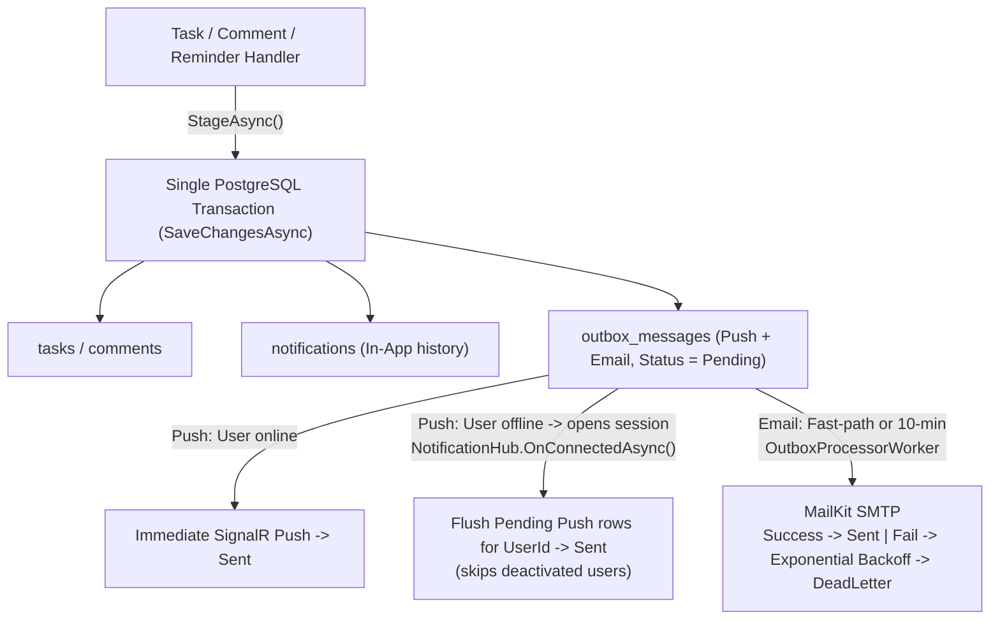

# TaskFlow (Taskaty) — Full-Stack Collaborative Task Management

A full-stack collaborative task management platform built with **ASP.NET Core (.NET 10)**, **PostgreSQL 17**, **SignalR**, **MailKit**, and **Angular 22.3**, designed around **Clean Architecture**, **custom CQRS**, **Transactional Outbox**, and **real-time session-aware notifications**.

> **New to this repo?** Jump to [Patterns & Engineering Concepts](#-patterns--engineering-concepts) for a map of every architectural pattern used and where to find it in the codebase, or [How to Run](#-how-to-run) to launch the entire stack in one Docker command.

### Quick Navigation
[Business Overview](#-business-overview) · [Patterns & Engineering Concepts](#-patterns--engineering-concepts) · [Architecture & Outbox Flow](#-architecture) · [Domain Model](#-domain-model) · [API Endpoints](#-api-endpoints) · [How to Run](#-how-to-run) · [Testing](#-testing) · [CI / CD](#-ci--cd-github-actions)

---

## 📌 Business Overview

### What is TaskFlow?
TaskFlow (branded **Taskaty** in the UI) lets small-to-medium teams manage work together — like a lightweight Trello/Asana/Jira: create tasks, assign them to teammates, drag cards across a shared Kanban board, discuss via comments, track progress on a dashboard, and receive reliable real-time push and email notifications.

### Core Business Capabilities

| Capability | Description | State |
|---|---|---|
| **User Accounts & Revocation** | Register, log in, manage profile, change password. Roles: `User`, `Manager`, `Admin`. Admins can deactivate accounts — login is blocked and existing JWTs stop working immediately | ✅ |
| **Task Lifecycle** | Create → Assign → Work (`Todo` → `InProgress` → `Done`) → Delete, with per-task ownership & role permissions | ✅ |
| **Kanban Board** | Team-shared card ordering per status column: drag a task above another or to the end, within or across columns, broadcast live to all connected clients | ✅ |
| **Prioritization & Deadlines** | `Low` / `Medium` / `High` priority, optional due dates, overdue filtering, and automatic 24-hour deadline reminders | ✅ |
| **Collaboration** | Paged comment threads on each task with author/Admin edit & delete controls | ✅ |
| **Reliable Notifications & Email** | In-app notifications stored atomically with the change, live SignalR push for online users, automatic session-open push flush for offline users, and transactional outbox email retries with exponential backoff | ✅ |
| **Oversight Dashboard** | Aggregated task counts by status, overdue & due-within-7-days metrics, personal assigned/created counts, unread notifications, and recently updated tasks | ✅ |
| **Access Control** | Role-based authorization (`User`, `Manager`, `Admin`) + resource ownership checks + per-IP auth rate limiting | ✅ |

### Example User Journey
1. A **Manager** logs in and receives a JWT token.
2. The Manager creates a task and assigns it to a teammate — the task, in-app `Notification`, and `Push` + `Email` `OutboxMessage` rows commit in **one PostgreSQL transaction**.
3. If the teammate is **online**, they receive the notification immediately over SignalR (`ReceiveNotification`); if **offline**, it stays `Pending` and is automatically flushed the moment they open a new session.
4. An assignment email is dispatched via MailKit (and automatically retried with exponential backoff if SMTP is temporarily down).
5. The teammate moves the task on the Kanban board (`PATCH /api/tasks/{id}/move`), broadcasting `BoardChanged` to the team, and adds comments.
6. Within 24 hours of the due date, the background reminder worker creates a single idempotent `DeadlineApproaching` notification + email.
7. The Manager tracks overall progress and overdue items via `GET /api/dashboard`.

---

## 🧠 Patterns & Engineering Concepts

Every major pattern and engineering concept used in this repository, **why** it is used, and **where** to inspect it:

### Architecture & Application Design

| Pattern / Concept | How It's Used in TaskFlow | Where to Look |
|---|---|---|
| **Clean Architecture (Ports & Adapters)** | 4 layers (`Domain` → `Application` ← `Infrastructure` & `API`). Dependencies point strictly inward; `Application` defines interfaces (ports) and never references EF Core, MailKit, or ASP.NET Core | `src/TaskFlow.Domain`, `src/TaskFlow.Application`, `src/TaskFlow.Infrastructure`, `src/TaskFlow.API` |
| **Custom CQRS (No MediatR)** | Explicit `ICommand<TResult>` / `ICommandHandler<TCommand, TResult>` and `IQuery<TResult>` / `IQueryHandler<TQuery, TResult>`. Custom `CommandDispatcher` and `QueryDispatcher` use cached typed `HandlerWrappers` (built once per request type) to invoke validation and handlers with zero reflection overhead per call | `src/TaskFlow.Application/Common/Dispatchers/`, `Commands/`, `Queries/` |
| **Validation Pipeline** | **FluentValidation** validators run automatically inside the dispatchers *after* controllers populate route/JWT fields, returning structured field errors (`400`) before handlers execute | `src/TaskFlow.Application/Common/Dispatchers/RequestValidation.cs`, `Validators/` |
| **Result Pattern** | Handlers return `Result<T>` instead of throwing exceptions for expected business outcomes, carrying a typed `ErrorType` (`Validation`, `NotFound`, `Conflict`, `Unauthorized`, `Forbidden`) | `src/TaskFlow.Application/Common/Results/Result.cs` |
| **RFC 9457 ProblemDetails & Global Exception Handling** | `ResultExtensions` maps `Result<T>` failures to `application/problem+json` with matching HTTP status codes; `GlobalExceptionHandler` catches unexpected exceptions, logs them, and returns a safe `500` ProblemDetails without leaking internals | `src/TaskFlow.API/Common/ResultExtensions.cs`, `GlobalExceptionHandler.cs` |
| **Options Pattern with Startup Validation** | Typed settings classes (`JwtSettings`, `SmtpSettings`, `ReminderSettings`, `OutboxSettings`) bound from configuration with `DataAnnotations` and `.ValidateOnStart()` so misconfiguration fails fast at boot | `src/TaskFlow.Application/Common/Settings/`, `src/TaskFlow.Infrastructure/Services/Email/SmtpSettings.cs` |
| **Immutable Record DTOs & Pagination** | C# `record` types for request/response DTOs and a generic `PaginatedList<T>` for consistent paged responses | `src/TaskFlow.Application/DTOs/` |

### Messaging, Reliability & Background Processing

| Pattern / Concept | How It's Used in TaskFlow | Where to Look |
|---|---|---|
| **Transactional Outbox Pattern** | `NotificationService.StageAsync` stages `Notification` and `OutboxMessage` rows (`Push`, plus `Email` for emailed types) in the **same PostgreSQL transaction** as the Task/Comment mutation (`IUnitOfWork.SaveChangesAsync`). Guarantees zero lost notifications or emails and ensures SignalR/SMTP outages never fail HTTP requests | `src/TaskFlow.Domain/Entities/OutboxMessage.cs`, `src/TaskFlow.Infrastructure/Services/NotificationService.cs`, `OutboxProcessor.cs` |
| **PostgreSQL `FOR UPDATE SKIP LOCKED` Claiming** | `OutboxProcessor` claims batches of due `Email` or `Pending` `Push` rows inside a short transaction (`Status = Processing`) using `FOR UPDATE SKIP LOCKED`, then releases the DB transaction before performing network I/O (SMTP/SignalR) so multiple API instances never double-send | `src/TaskFlow.Infrastructure/Services/OutboxProcessor.cs` |
| **Exponential Backoff & Dead-Lettering** | Failed email deliveries increment `AttemptCount`, capture `LastError`, and schedule `NextAttemptAt` with exponential backoff (`10m → 20m → 40m → 80m` via `Outbox:BaseRetryDelayMinutes`). After `MaxAttempts` (`5`), rows transition to `DeadLetter` and stop retrying | `src/TaskFlow.Domain/Entities/OutboxMessage.cs`, `OutboxProcessor.cs` |
| **Active Connection Tracking & Session-Open Push Flush** | Singleton `UserConnectionTracker` (`ConcurrentDictionary<Guid, int>`) tracks live SignalR connections per user (safe across multiple open tabs). Online users get immediate SignalR push (`Sent`); offline users' `Push` rows stay `Pending` and flush automatically on `NotificationHub.OnConnectedAsync` (skipping deactivated users) | `src/TaskFlow.API/Services/UserConnectionTracker.cs`, `src/TaskFlow.API/Hubs/NotificationHub.cs` |
| **Strongly-Typed SignalR Hub** | `Hub<INotificationClient>` at `/hubs/notifications` (JWT via `access_token` query string) pushes `ReceiveNotification` via `Clients.User(userId)` and broadcasts `BoardChanged` via `Clients.All` | `src/TaskFlow.API/Hubs/NotificationHub.cs`, `src/TaskFlow.API/Services/RealTimeNotifier.cs`, [docs/REALTIME.md](docs/REALTIME.md) |
| **Periodic Background Workers (`BackgroundService` + `PeriodicTimer`)** | Scoped work inside `IServiceScopeFactory` loops: `OutboxProcessorWorker` (every 10 min: retries due emails + purges old `Sent` rows via `ExecuteDeleteAsync`) and `DeadlineReminderWorker` (every 15 min: idempotent reminders serialized via `SemaphoreSlim`) | `src/TaskFlow.Infrastructure/BackgroundJobs/OutboxProcessorWorker.cs`, `DeadlineReminderWorker.cs` |

### Data Access & Persistence

| Pattern / Concept | How It's Used in TaskFlow | Where to Look |
|---|---|---|
| **Repository & Unit of Work** | Generic `IRepository<T>` with read-only `AsNoTracking()` projections (`ListAsync`), SQL-translated paging, `GROUP BY` aggregations (`CountByAsync`), and `IUnitOfWork.ExecuteInTransactionAsync` wrapping EF Core's `CreateExecutionStrategy()` for retry-safe transactions | `src/TaskFlow.Domain/Interfaces/`, `src/TaskFlow.Infrastructure/Data/Repositories/` |
| **UUIDv7 Primary Keys** | `BaseEntity.Id` uses `Guid.CreateVersion7()` (time-ordered GUIDs) so inserts append sequentially to PostgreSQL B-tree primary-key indexes instead of fragmenting them | `src/TaskFlow.Domain/Common/BaseEntity.cs` |
| **EF Core Fluent API, `snake_case`, UTC & `jsonb`** | Dedicated `IEntityTypeConfiguration<T>` classes, `EFCore.NamingConventions` (`snake_case`), global UTC `DateTime` value converters (`timestamptz`), `jsonb` payloads on `outbox_messages`, composite indexes, and automatic `CreatedAt`/`UpdatedAt` auditing in `SaveChangesAsync` | `src/TaskFlow.Infrastructure/Data/Context/ApplicationDbContext.cs`, `Configurations/`, [docs/DATABASE.md](docs/DATABASE.md) |
| **Idempotent Migrations & Seeding** | Code-first EF Core migrations applied automatically in Development alongside an idempotent `DataSeeder` (only inserts missing records); production applies migrations explicitly | `src/TaskFlow.Infrastructure/Data/Migrations/`, `Seeding/DataSeeder.cs` |

### Security & Hardening

| Pattern / Concept | How It's Used in TaskFlow | Where to Look |
|---|---|---|
| **JWT Bearer + Immediate Token Revocation (`SecurityStamp`)** | Self-issued JWTs (32+ byte secret from user-secrets/env). Every authenticated request validates `IsActive` and `SecurityStamp` via one primary-key lookup in `JwtBearerEvents.OnTokenValidated`, so account deactivation, password change, or role change immediately invalidates all existing tokens | `src/TaskFlow.API/Program.cs`, `src/TaskFlow.API/Common/ActiveUserTokenCheck.cs` |
| **BCrypt Password Hashing** | Adaptive salted hashing for all user passwords | `src/TaskFlow.Infrastructure/Services/PasswordService.cs` |
| **RBAC + Ownership Guards** | Role-based `[Authorize(Roles = "Admin")]` plus domain/application ownership checks (e.g., `TaskItem.CanBeEditedBy`, last-active-Admin protection) | `src/TaskFlow.Application/Commands/Tasks/TaskCommandGuards.cs`, `Users/UserCommandGuards.cs` |
| **Fixed-Window Rate Limiting & Strict CORS** | Per-IP fixed-window rate limiter (`429` + `Retry-After`) on auth endpoints (`/login`, `/register`, `/change-password`); CORS allow-list driven strictly by `Cors:AllowedOrigins` | `src/TaskFlow.API/Common/RateLimiting.cs`, `Program.cs` |

### Frontend (`TaskFlow.Web`) & DevOps

| Pattern / Concept | How It's Used in TaskFlow | Where to Look |
|---|---|---|
| **Modern Angular 22.3 SPA** | Standalone components, Signals-based state management, Tailwind CSS v4, Angular CDK Kanban drag-and-drop board, `@microsoft/signalr` live updates, bilingual `en`/`ar` i18n, and Vitest + ESLint | `src/TaskFlow.Web/src/app/` |
| **Reverse Proxy & Containerized Stack** | Multi-stage Dockerfiles; Nginx serves the Angular SPA and reverse-proxies `/api/` and `/hubs/` WebSockets to the .NET API inside Docker Compose (PostgreSQL 17, Mailpit, API, Web) | `docker-compose.yml`, `src/TaskFlow.API/Dockerfile`, `src/TaskFlow.Web/Dockerfile`, `nginx.conf` |
| **Real-Dependency Integration Testing** | xUnit + `WebApplicationFactory<Program>` + **Testcontainers** (throw-away PostgreSQL 17 & Mailpit containers) testing full HTTP, EF Core migrations, SignalR, SMTP, and Outbox flows | `tests/TaskFlow.IntegrationTests/` |

---

## 🏗️ Architecture

```
┌──────────────────────────────────────────────────────────┐
│ TaskFlow.API                                             │
│ Controllers (Auth, Users, Tasks, Comments, Notifications,│
│ Dashboard, Reminders, Outbox), NotificationHub,          │
│ RealTimeNotifier, UserConnectionTracker, Program.cs      │
└────────────────────────────┬─────────────────────────────┘
                             │ depends on
┌────────────────────────────▼─────────────────────────────┐
│ TaskFlow.Infrastructure                                  │
│ ApplicationDbContext, Fluent configurations, migrations, │
│ Repository/UnitOfWork, DataSeeder, NotificationService,  │
│ OutboxProcessor, OutboxProcessorWorker, MailKit SMTP,    │
│ DeadlineReminderWorker, JWT & BCrypt services            │
└────────────────────────────┬─────────────────────────────┘
                             │ implements ports of
┌────────────────────────────▼─────────────────────────────┐
│ TaskFlow.Application                                     │
│ Commands / Queries + Handlers, FluentValidation, DTOs,   │
│ Custom Dispatchers, Result<T>, Settings, Ports           │
│ (INotificationService, IOutboxProcessor,                 │
│  IUserConnectionTracker, IRealTimeNotifier, ...)         │
└────────────────────────────┬─────────────────────────────┘
                             │ depends on
┌────────────────────────────▼─────────────────────────────┐
│ TaskFlow.Domain                                          │
│ BaseEntity (UUIDv7), Entities, Enums,                    │
│ IRepository<T>, IUnitOfWork                              │
└──────────────────────────────────────────────────────────┘
```

### Transactional Outbox & Delivery Flow



### Project Layout

```
src/
  TaskFlow.Domain/          Common/BaseEntity (UUIDv7), Entities/, Enums/, Interfaces/
  TaskFlow.Application/     Commands/, Queries/, Validators/, DTOs/, Common/ (Dispatchers, Email, Notifications, Reminders, Results, Settings, Interfaces)
  TaskFlow.Infrastructure/  Data/ (Context, Configurations, Migrations, Repositories, Seeding), Services/ (incl. OutboxProcessor, Email/), BackgroundJobs/
  TaskFlow.API/             Common/ (ProblemDetails, ExceptionHandler, RateLimiting, ActiveUserTokenCheck), Controllers/, Hubs/, Services/, Program.cs, Dockerfile
  TaskFlow.Web/             Angular 22.3 frontend (Signals, Tailwind CSS v4, CDK Board, SignalR, i18n), nginx.conf, Dockerfile
docs/                       DATABASE.md, REALTIME.md, BUGFIXES.md, DOCKER_AND_CI_GUIDE.md
postman/                    TaskFlow.postman_collection.json (automated assertions)
tests/                      TaskFlow.IntegrationTests (120 tests: xUnit, WebApplicationFactory, Testcontainers)
docker-compose.yml          Full stack: PostgreSQL 17, Mailpit, TaskFlow.API, TaskFlow.Web (Nginx)
```

---

## 📂 Domain Model

```
users               tasks                    comments          notifications           outbox_messages
├─ id (UUIDv7)      ├─ id (UUIDv7)           ├─ id (UUIDv7)    ├─ id (UUIDv7)          ├─ id (UUIDv7)
├─ first_name       ├─ title                 ├─ content        ├─ user_id (FK)         ├─ channel (Push|Email)
├─ last_name        ├─ description           ├─ task_id (FK)   ├─ message              ├─ status (Pending|Processing|Sent|DeadLetter)
├─ email (unique)   ├─ status                ├─ user_id (FK)   ├─ type                 ├─ recipient_user_id
├─ password_hash    ├─ priority              ├─ created_at     ├─ is_read              ├─ notification_id (FK, SET NULL)
├─ role             ├─ due_date              └─ updated_at     ├─ related_task_id (FK) ├─ payload_json (jsonb)
├─ is_active        ├─ position                                ├─ created_at           ├─ attempt_count / max_attempts
├─ security_stamp   ├─ created_by_user_id (FK)                 └─ updated_at           ├─ next_attempt_at
├─ created_at       ├─ assigned_to_user_id (FK)                                        ├─ processed_at
└─ updated_at       ├─ created_at                                                      ├─ last_error
                    └─ updated_at                                                      ├─ created_at / updated_at
```

- **Enums stored as text:** `status` (`Todo | InProgress | Done`), `priority` (`Low | Medium | High`), `role` (`User | Manager | Admin`), `notification_type` (`TaskAssigned | TaskUpdated | TaskCompleted | CommentAdded | DeadlineApproaching`), `outbox_channel` (`Push | Email`), `outbox_status` (`Pending | Processing | Sent | DeadLetter`).
- **Referential integrity:** Deleting a task cascades to its comments and sets `notifications.related_task_id = NULL` (preserving history). Deleting a notification sets `outbox_messages.notification_id = NULL`.
- **Composite indexes:** `(status, position)` on `tasks` for board ordering; `(user_id, is_read)` on `notifications`; `(channel, status, next_attempt_at)` and `(recipient_user_id, channel, status)` on `outbox_messages`.

---

## 🔌 API Endpoints

All endpoints except `/health`, `/api/auth/register`, and `/api/auth/login` require a `Bearer` JWT token.

| Method | Route | Who | Description |
|---|---|---|---|
| GET | `/health` | anyone | Health check (`{ "status": "ok" }`) |
| POST | `/api/auth/register` | anyone | Create an account (role `User`) |
| POST | `/api/auth/login` | anyone | Get a JWT (inactive accounts are rejected) |
| POST | `/api/auth/change-password` | logged in | Change own password; rotates `SecurityStamp` to sign out all existing sessions |
| GET | `/api/users` | logged in | List users (with `isActive`); `?isActive=true\|false` |
| GET | `/api/users/me` | logged in | Current user |
| GET | `/api/users/{id}` | logged in | One user |
| PUT | `/api/users/{id}` | self or Admin | Update name/email |
| PUT | `/api/users/{id}/role` | Admin | Change role (cannot demote last active Admin); revokes existing tokens |
| PATCH | `/api/users/{id}/active` | Admin | Deactivate `{ "isActive": false }` or reactivate `true` (cannot deactivate self or last active Admin) |
| DELETE | `/api/users/{id}` | self or Admin | Delete (blocked if the user created tasks) |
| GET | `/api/tasks` | logged in | List tasks: filters `status`, `priority`, `assignedToId`, `unassigned`, `createdById`, `overdue`; `sort=createdAt\|position`; paging `page`, `pageSize` |
| GET | `/api/tasks/{id}` | logged in | One task with names and comment count |
| POST | `/api/tasks` | logged in | Create a task (creator = caller) |
| PUT | `/api/tasks/{id}` | creator, Manager, Admin | Replace title, description, priority, due date, status, assignee |
| PATCH | `/api/tasks/{id}/status` | creator, assignee, Manager, Admin | Change status: `{ "status": "InProgress" }` (appends to end of target column) |
| PATCH | `/api/tasks/{id}/move` | creator, assignee, Manager, Admin | Board drag & drop: `{ "status": "Done", "beforeTaskId": "<guid>" }` (`null` = end of column) |
| PATCH | `/api/tasks/{id}/assignee` | creator, Manager, Admin | Assign `{ "assignedToId": "<guid>" }` or unassign with `null` (active users only) |
| DELETE | `/api/tasks/{id}` | creator, Admin | Delete a task (cascades to comments) |
| GET | `/api/tasks/{taskId}/comments` | logged in | Task comments, oldest first, with author names; paging `page`, `pageSize` |
| POST | `/api/tasks/{taskId}/comments` | logged in | Add a comment `{ "content": "..." }` (1–1000 chars; author = caller) |
| PUT | `/api/comments/{id}` | author | Edit a comment |
| DELETE | `/api/comments/{id}` | author, Admin | Delete a comment |
| GET | `/api/notifications` | logged in (own) | Your notifications, newest first; `unread=true\|false`, `page`, `pageSize` |
| GET | `/api/notifications/unread-count` | logged in (own) | Number of unread notifications |
| PATCH | `/api/notifications/{id}/read` | logged in (own) | Mark one as read (404 if not yours) |
| POST | `/api/notifications/read-all` | logged in (own) | Mark all as read; returns count updated |
| GET | `/api/dashboard` | logged in | Team task counts by status, overdue & due-within-7-days, personal assigned/created counts, unread count, 5 recently updated tasks |
| POST | `/api/reminders/run` | Admin | Trigger deadline reminders now (worker also runs every 15 min) |
| POST | `/api/outbox/process` | Admin | Process due `Email` outbox rows now (worker also polls every 10 min) |
| WS | `/hubs/notifications` | logged in | SignalR hub: receives `ReceiveNotification` (incl. offline flush on connect) and `BoardChanged` ([docs/REALTIME.md](docs/REALTIME.md)) |

### Responses & Errors

Success responses return `200 OK` with `{ "isSuccess": true, "data": { ... } }`. Failures return **RFC 9457 ProblemDetails** (`application/problem+json`):

```json
{
  "type": "https://tools.ietf.org/html/rfc9110#section-15.5.5",
  "title": "NotFound",
  "status": 404,
  "detail": "Task not found",
  "traceId": "00-..."
}
```

| Status | `title` | When |
|---|---|---|
| `400` | `Validation` | FluentValidation or model-binding errors (includes `errors` per field), invalid enum/sort/assignee, wrong current password |
| `401` | `Unauthorized` | Missing/invalid/revoked JWT, deactivated/deleted user, or failed login |
| `403` | `Forbidden` | Authenticated but lacks role or resource ownership |
| `404` | `NotFound` | Resource does not exist (or belongs to another user for private resources) |
| `409` | `Conflict` | Duplicate email, deleting a user with created tasks, demoting/deactivating last active Admin |
| `429` | `TooManyRequests` | Auth IP rate limit exceeded (check `Retry-After` header) |
| `500` | `Failure` | Unexpected error (logged server-side; no internals leaked) |

---

## ✅ Current Status

| Area | Status |
|---|---|
| Domain entities, enums, EF Fluent configurations, UUIDv7 keys, composite indexes | ✅ Done |
| PostgreSQL 17 + EF Core migrations + idempotent seed data (Docker Compose) | ✅ Done |
| Repository / Unit of Work (no-tracking projections, paging, `CountByAsync`, resilient transactions) | ✅ Done |
| Custom CQRS dispatchers (cached typed wrappers, validation step), `Result<T>`, FluentValidation | ✅ Done |
| Security: JWT + `SecurityStamp` revocation, BCrypt, RBAC/ownership guards, CORS, auth rate limiting | ✅ Done |
| Users, Tasks, Kanban Board positioning (`PATCH /move`), Comments, Dashboard | ✅ Done |
| Transactional Outbox (`outbox_messages`), `OutboxProcessor` (`FOR UPDATE SKIP LOCKED`), 10-min retry worker, exponential backoff → `DeadLetter`, retention cleanup | ✅ Done |
| SignalR typed hub (`ReceiveNotification`, `BoardChanged`), `UserConnectionTracker`, automatic session-open push flush | ✅ Done |
| Email (MailKit + Mailpit in Docker) & Deadline reminders (`BackgroundService` + `POST /api/reminders/run`) | ✅ Done |
| Angular 22.3 frontend (`TaskFlow.Web`) with Kanban board, live SignalR updates, Tailwind CSS v4, and `en`/`ar` i18n | ✅ Done |
| Automated tests | ✅ **120 integration tests** (xUnit + Testcontainers PostgreSQL 17 & Mailpit): auth, users, activation, token revocation, tasks, lifecycle, position, comments, notifications + SignalR, transactional outbox (push flush, backoff retry, dead-lettering, cleanup), dashboard, deadline reminders, email, validation, dispatchers, CORS, rate limiting |

---

## 🚀 How to Run

### Option 1: Full Stack with Docker Compose (Recommended)

Prerequisite: **Docker Desktop**.

```powershell
# 1. Configure environment variables (set POSTGRES_PASSWORD and a 32+ char JWT_SECRET)
Copy-Item .env.example .env

# 2. Build and start all 4 services (postgres, mailpit, api, web)
docker compose up -d --build

# 3. Verify all services are healthy
docker compose ps
```

- **Web App:** `http://localhost:4200` (Nginx serves Angular and reverse-proxies `/api/` and `/hubs/` WebSockets)
- **API Swagger UI:** `http://localhost:8080/swagger` (when `ASPNETCORE_ENVIRONMENT=Development`)
- **API Health Check:** `http://localhost:8080/health`
- **Mailpit Web UI:** `http://localhost:8025` (catches all outgoing emails in Docker)

### Option 2: Hybrid Local Development (Host API + Web, Docker Postgres + Mailpit)

Prerequisites: **.NET 10 SDK**, **Node.js**, and **Docker Desktop**. Full setup & seeded data details: **[docs/DATABASE.md](docs/DATABASE.md)**.

```powershell
# 1. Start PostgreSQL and Mailpit
docker compose up -d postgres mailpit

# 2. Run the API (Development auto-applies migrations and seeds data on start)
cd src\TaskFlow.API
dotnet run --launch-profile https

# 3. Run the Angular web app (in a separate terminal)
cd src\TaskFlow.Web
npm install
npm start
```

- **Web App:** `http://localhost:4200`
- **Swagger UI:** `https://localhost:7103/swagger`

**Seeded logins** (password `P@ssw0rd`): `admin@taskflow.dev`, `manager@taskflow.dev`, `user@taskflow.dev`, `user2@taskflow.dev`, and deactivated `inactive@taskflow.dev`.

When running the API directly on the host, SMTP is disabled by default (`Smtp:Enabled=false`). To deliver emails to Mailpit (`http://localhost:8025`), pass `--Smtp:Enabled=true` or set it in user-secrets.

---

## 🧪 Testing

- **Backend integration tests (120 tests):** `dotnet test -c Release` (Docker must be running). Runs the real API in memory (`WebApplicationFactory<Program>`) against throw-away PostgreSQL 17 and Mailpit containers via Testcontainers — never touches your local dev database.
- **Frontend tests & lint:** inside `src/TaskFlow.Web`, run `npm test` (Vitest) and `npm run lint` (ESLint).
- **Postman collection:** import [postman/TaskFlow.postman_collection.json](postman/TaskFlow.postman_collection.json) and run with Collection Runner.
- **Database shell:** `docker exec -it taskflow-postgres psql -U taskflow -d taskflow` (or connect on `localhost:5433`).
- **Reset dev DB:** `dotnet run -- --Seed:ResetDatabase=true` in `src/TaskFlow.API`.

---

## ⚙️ CI / CD (GitHub Actions)

- **CI (`.github/workflows/ci.yml`):** Runs on pushes and pull requests to `main`, executing parallel `.NET 10` (build + 120 Testcontainers integration tests) and `Angular 22.3` (ESLint, Vitest, production build) jobs.
- **Automated Deployment (`.github/workflows/deploy.yml`):** On pushes to `main` (or manual dispatch), connects to the target server over SSH, pulls `main`, and redeploys the Docker Compose stack (`docker compose up -d --build --remove-orphans`).
